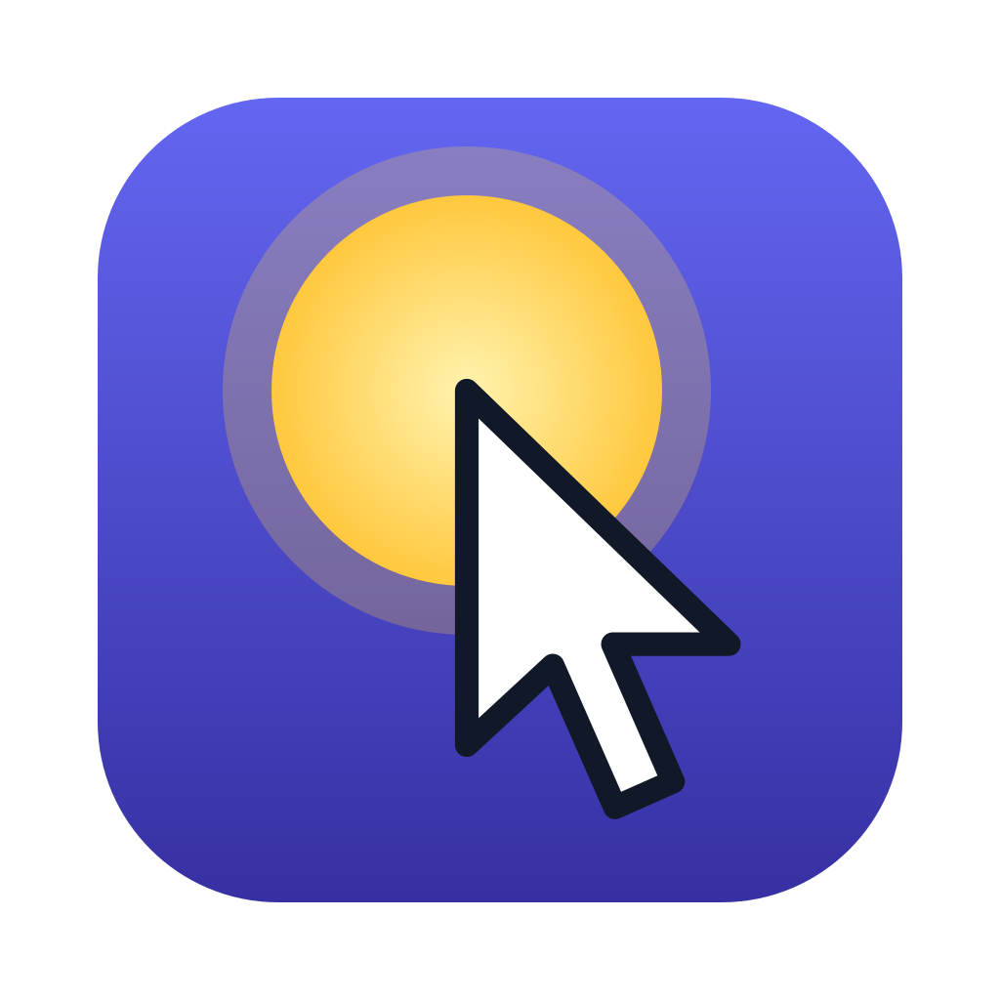

# MacCursor

A free, open-source macOS menu bar app that makes your cursor impossible to miss on calls, screen shares and recordings. Your pointer becomes a **dog paw** (or a cat paw, a pointing finger or a highlight ring) that reaches in from the edge of the screen and *boops* every click.

> **Status: early development (pre-0.1).** See [IDEA.md](IDEA.md) for the product plan.

## Features

- Click-through overlay on every display. Clicking, dragging, scrolling and selecting work as normal.
- Styles: **Dog paw**, **Cat paw**, **Cartoon hand**, **Highlight ring** (original art), and any style you import or make yourself (see [Styles](#styles))
- **Size** slider in the menu (0.4× to 1.6×, applied live)
- **Light / Dark / Auto** colors. Auto follows the system appearance: a dark outline on light screens, a light "sticker" outline on dark screens.
- Hides the real system cursor, so you never see two pointers (optional; the ring keeps the arrow inside it). Uses a private macOS API, see below.
- Follows the cursor at your display's refresh rate (up to 120 Hz), and uses almost no CPU when the mouse is still.
- Shows up in full-screen shares and recordings.
- Click feedback: a ripple and a paw-print stamp. Fast clicking adds bones (dog), hearts (cat) or dots. Moods: Subtle / Normal / Wild. Click sound (toggle).
- **Presentation mode** (prototype): clicks animate but never reach apps, and the keyboard keeps working.
- Hotkeys: `⌃⌥P` toggles the pointer, `⌃⌥T` toggles presentation mode.

## Install

1. Download `MacCursor-X.Y.Z.zip` from the [latest release](https://github.com/eugenesaz/MacCursor/releases/latest) and open it.
2. Move **MacCursor** to `Applications` (or `~/Applications` in your home folder, which lets updates install without an admin password).
3. Open it. macOS says **"MacCursor.app" Not Opened**, because MacCursor is free and isn't notarized by Apple (that needs a paid developer account). Click **Done** (not Move to Trash), then go to **System Settings › Privacy & Security**, scroll down and click **Open Anyway**. You only do this once.

Requires macOS 26 or later.

### Updates

MacCursor checks for a new version once a day and asks before installing it. You can also choose **Check for Updates…** in the menu. Updates are signed, and MacCursor only installs ones signed with the project's key.

## Styles

Get a style from a friend or online as a `.maccursorstyle` file, then choose **Import Style…** in
MacCursor's menu. You see a preview first; the style is selected as soon as it's imported.
**Remove Style…** moves one to the Trash.

**Make your own:** draw it in any vector editor (Figma, Inkscape, Illustrator, Affinity) and
follow [Making a style](docs/making-a-style.md). A style is just an SVG and a short `style.json`,
and MacCursor redraws it live each time you save. The format: [docs/style-packs.md](docs/style-packs.md).
Licence rules for sharing: [CONTRIBUTING.md](CONTRIBUTING.md).

A style is pictures only: it can't run code or load anything from the internet, and MacCursor
checks every file before using it.

## Build from source

Needs the Xcode Command Line Tools (`xcode-select --install`).

```sh
./scripts/make-signing-identity.sh  # once: a local signing identity, so permissions survive rebuilds
./scripts/check.sh                  # format lint, build, all tests
./scripts/bundle.sh                 # → build/MacCursor.app (CODESIGN_IDENTITY=- for ad-hoc)
open build/MacCursor.app            # paw icon appears in the menu bar
```

Render every style, palette and size to PNGs (no permissions needed):

```sh
build/MacCursor.app/Contents/MacOS/MacCursor --render build/snapshots
```

The scripts use bash and apply a workaround for a known broken Command Line Tools install (`scripts/swift-env.sh`); on a healthy install it does nothing.

### Permissions
- **None** for the pointer and click effects.
- **Accessibility** only for presentation mode, which blocks clicks. With the local signing identity, the permission survives rebuilds; an ad-hoc build needs it granted again.

### About the private API
macOS doesn't let a background app hide the system cursor. MacCursor registers a blank cursor through the private SkyLight framework instead (technique credit: [Cursorlight](https://github.com/Zawalid/Cursorlight), MIT). If a future macOS removes it, MacCursor keeps working and the arrow simply stays visible. You can also turn it off: **Hide system cursor** in the menu.

## Project layout

| Path | What |
|---|---|
| `Sources/MacCursorCore/` | Pure logic, fully unit-tested: settings, display geometry, cursor policy |
| `Sources/MacCursorRender/` | Style packs (SVG and manifest reader, pack files, library), the pointer layers and click effects, the snapshot renderer |
| `Resources/Styles/` | The built-in styles, as style packs |
| `Sources/MacCursorApp/` | The menu bar app: overlay windows, tracking, cursor hiding, hotkeys, presentation mode, style import, command-line tools |
| `Tests/` | swift-testing unit tests and snapshot tests (reference PNGs in `Tests/MacCursorRenderTests/Snapshots/`) |
| `docs/manual-test.md` | What to check by hand before merging and releasing |

Releases: see [docs/releasing.md](docs/releasing.md).

## License

[MIT](LICENSE). Third-party notices: [THIRD_PARTY_NOTICES.md](THIRD_PARTY_NOTICES.md).
